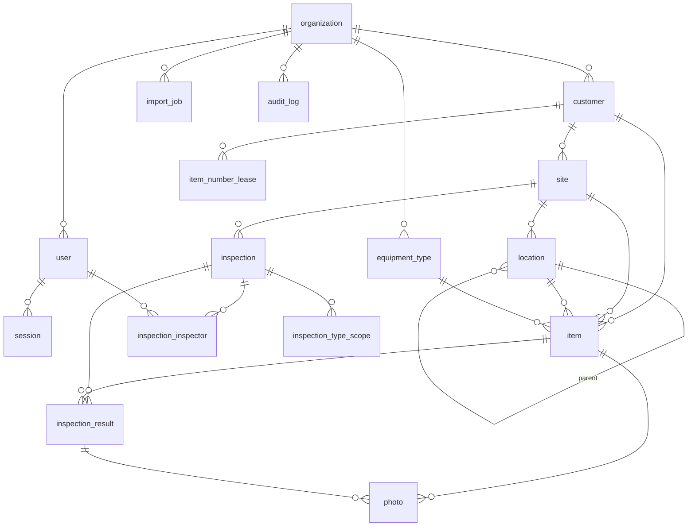

# Architektura – Revize (fáze 1)

> Schválený návrh (2026-10-26). Stav: M0, M2, M3 hotovo; M1 čeká na další kolo testu na iPadu. Rozhodnutí jsou rozepsaná v `docs/adr/`, licence v `docs/licenses.md`.

## Kontext

Prázdný adresář, greenfield. Cíl fáze 1: funkční prototyp pro revizní techniky (terén = iPad PWA,
kancelář = prohlížeč), self-hosted zdarma (Docker Compose), architektura připravená na QR štítky,
Capacitor, další typy vybavení a multi-tenant. Prvním milníkem je QR spike.

### Rozhodnutí z otázek

- Vzdálený přístup: nechávám na mém doporučení → výchozí **Tailscale**, ostatní varianty popsány (§5).
- Hodnocení: **OK / Závada / Závada + vyřazení** (pevně, ne konfigurovatelně).
- Kontrola = **jedna provozovna, více techniků současně**, volitelně omezená na typy vybavení.
- Číslo artiklu: **technik zadá, nebo systém přidělí** (offline z předem rezervovaného bloku).
- Repo: `github.com/vitekdynka-debug/Revize`.
- Spike: nasazení na **GitHub Pages**.
- sharp/libvips (LGPL) i ExifTool (Artistic/GPL) schváleny; vše evidovat v `docs/licenses.md`.

### Pracovní předpoklady (uživatel může opravit)

1–5 techniků, stovky až nízké tisíce artiklů na zákazníka; server x86; datum příští kontroly
per artikl (interval z typu), kontrola nese souhrnné datum (přepsatelné); QR kód globálně unikátní,
číslo artiklu unikátní v rámci zákazníka; jedno PDF na kontrolu se sekcemi podle typů; vyřazený
artikl zůstává v evidenci, návrat do provozu jen auditovaně z kanceláře.

## 1. Architektura

```
iPad (PWA, terén)  ─┐                         ┌─ PostgreSQL 16
PC/Mac (kancelář) ──┼─ HTTPS ─ Caddy ─┬─ web (statické soubory)
                    │  (Tailscale /   └─ api (Fastify) ─┼─ FileStorage (lokální disk /data/files)
                    │   CF / LE)                        └─ Chromium (PDF), exiftool, sharp
```

Monorepo (pnpm workspaces):

- `packages/shared` – doménové typy, Zod schémata API, **dynamické schéma polí typu vybavení**
  (definice → Zod; používá formulář, API i import), doménová pravidla (výpočet příští kontroly,
  stavy kontroly, progress), čeština enumů. Bez závislosti na prohlížeči/Node.
- `apps/api` – Fastify, moduly podle domény (`modules/customers`, `items`, `inspections`, `photos`,
  `exports`, `imports`, `auth`, `audit`), každý: routes → service → repository (Drizzle).
  Infrastruktura za rozhraními: `FileStorage` (LocalDiskStorage; později S3-kompatibilní),
  `PdfRenderer` (Playwright), `ImageProcessor` (sharp), `MetadataWriter` (exiftool), `Clock`.
- `apps/web` – React + Vite, dvě „shell" části v jednom buildu: `/field/*` (dotyková, PWA)
  a `/office/*` (tabulky). Platformní adaptéry v `src/platform/`:
  `CameraService`, `ScannerService`, `FileExport`, `LocalStore`, `Feedback` (zvuk/haptika),
  `Connectivity` – implementace `web/*`, později `capacitor/*`, volba při startu.
- `apps/spike-qr` – samostatná minimální PWA pro M1 (po spiku se skener přesune do `apps/web`).
- `e2e/` – Playwright testy (viewport iPad).

Multi-tenant připraveno od začátku: `organization_id` na všech tenantových tabulkách, zatím jedna
organizace; oprávnění v kódu jako **permissions** (`inspection.close`, `item.write`…) mapované z rolí,
role `admin`, `inspector` – další role = jen nový řádek v mapě.

## 2. Technologie a licence

| Oblast         | Volba                                                                                   | Licence                                   | Proč                                                                                                   |
| -------------- | --------------------------------------------------------------------------------------- | ----------------------------------------- | ------------------------------------------------------------------------------------------------------ |
| Jazyk/monorepo | TypeScript, pnpm workspaces                                                             | Apache-2.0 / MIT                          | zadání                                                                                                 |
| Backend        | **Fastify 5** + `fastify-type-provider-zod` + `@fastify/swagger`                        | MIT                                       | lehčí a průhlednější než NestJS, Zod schémata ze `shared` → validace + OpenAPI z jednoho zdroje        |
| ORM            | **Drizzle ORM** + drizzle-kit (SQL migrace)                                             | Apache-2.0                                | SQL-first, dobrá práce s JSONB, rekurzivní CTE, bez binárního enginu; migrace jsou čitelné SQL soubory |
| DB             | PostgreSQL 16                                                                           | PostgreSQL                                | zadání                                                                                                 |
| Auth           | vlastní: `@node-rs/argon2`, DB sessions, httpOnly cookie                                | MIT                                       | viz §6                                                                                                 |
| Frontend       | React 19, Vite, TanStack Router/Query/Table                                             | MIT                                       | typové routy, cache dotazů, tabulky s řazením/filtry                                                   |
| UI kit         | **Mantine** (+ dates, notifications)                                                    | MIT                                       | hotové formuláře, tabulky, česká lokalizace, dotykově použitelné                                       |
| PWA            | vite-plugin-pwa (Workbox)                                                               | MIT                                       | service worker, manifest                                                                               |
| IndexedDB      | Dexie                                                                                   | Apache-2.0                                | cache + fronta zápisů + Bloby fotek                                                                    |
| QR             | **zxing-wasm** (zxing-cpp) ve Web Workeru; nativní `BarcodeDetector`, je-li k dispozici | MIT / Apache-2.0                          | nejrychlejší OSS dekodér v prohlížeči; spike porovná                                                   |
| XLSX/CSV       | exceljs, papaparse                                                                      | MIT                                       | export i import; CSV v UTF-8 s BOM, `;` (český Excel)                                                  |
| ZIP            | archiver (stream)                                                                       | MIT                                       |                                                                                                        |
| PDF            | Playwright Chromium, HTML šablona přes React `renderToStaticMarkup`, fonty Noto Sans    | Apache-2.0 / OFL                          | čeština, stránkování (`@page`, page-break)                                                             |
| Náhledy        | sharp (libvips)                                                                         | Apache-2.0 (+ **LGPL-3.0** libvips)       | schváleno                                                                                              |
| EXIF/IPTC      | ExifTool přes exiftool-vendored                                                         | MIT wrapper (+ **Artistic/GPL** ExifTool) | schváleno                                                                                              |
| Logy           | pino                                                                                    | MIT                                       |                                                                                                        |
| Testy          | Vitest, Playwright Test, Testcontainers (Postgres)                                      | MIT / Apache-2.0                          |                                                                                                        |
| Proxy          | Caddy 2                                                                                 | Apache-2.0                                | automatické HTTPS                                                                                      |
| Zálohy         | pg_dump + rsync (snapshoty `--link-dest`)                                               | PostgreSQL / GPL (nástroj, nelinkuje se)  | bez dalších závislostí                                                                                 |

Vše zapsáno do `docs/licenses.md` (vč. upozornění na LGPL/Artistic/GPL nástroje).

## 3. Datový model (ERD)



Klíčové tabulky a sloupce (všechna PK `uuid`, generovaná i na klientovi; všude `organization_id`,
`created_at`, `updated_at`, `version int` pro optimistické zamykání):

- `user` (email unikátní, password_hash, display_name, role, active), `session` (token hash, expires, device_label).
- `customer` (name, ičo, adresa, kontakt), `site` (customer_id, name, adresa).
- `location` (site_id, parent_id, name, `sort_order`, **materializovaná `path_ids uuid[]` a `sort_path text`**
  udržované v transakci) – libovolná hloubka, řazení podle cesty bez rekurze, podstrom přes `path_ids @>`.
- `equipment_type` (name, `field_definitions jsonb` – pole: key, label, kind [text, number, integer,
  date, boolean, select, multiselect], required, options, order, unit, `archived`), `default_interval_months`,
  `protocol_template` (text s jednoduchými placeholdery), `schema_version`. Klíče polí jsou neměnné,
  odebrané pole se archivuje (data artiklů zůstávají).
- `item` (customer_id, site_id, location_id, equipment_type_id, `item_number` varchar(8), číselná řada bez úvodních nul (ADR-0012) – unique
  (customer_id, item_number), `qr_code` text unique per organizace nullable, `field_values jsonb`
  validované v API podle typu, `status` [in_service, out_of_service], `next_inspection_date`,
  `retired_at`, `created_by`).
- `item_number_lease` (customer_id, device/user, range_from, range_to, expires) – rezervace bloku čísel pro offline.
- `inspection` (site_id, customer_id, lead_inspector_id, `inspection_date`, `next_inspection_date`,
  `status` [open, closed], closed_at/by, reopened_count), `inspection_inspector` (M:N),
  `inspection_type_scope` (prázdné = všechny typy).
- `inspection_result` (inspection_id, item_id – **unique pár**, `outcome` [ok, defect],
  `defect_description`, `taken_out_of_service bool` (jen při defect), `recorded_at` (čas na zařízení),
  `recorded_by`, `client_mutation_id`). Absence řádku = nezkontrolováno.
- `photo` (`item_id` XOR `inspection_result_id` – CHECK), storage_key originálu + náhledu, mime,
  width/height, size, sha256, taken_at, caption, upload_status.
- `audit_log` (actor, action, entity_type, entity_id, before jsonb, after jsonb, reason, at).
- `import_job` (+ `import_job_row`): soubor, mapování, stav, chyby po řádcích.

Pravidla: uzavřená kontrola odmítá zápis (409), znovuotevření jen s důvodem → audit; při
`taken_out_of_service` server nastaví artikl na `out_of_service`; při uzavření kontroly se
přepočítá `next_inspection_date` artiklů. Historie artiklu = všechny kontroly jeho provozovny
(v rozsahu typu, v době existence artiklu) LEFT JOIN výsledky → „OK / závada / nezkontrolován".

## 4. Fronta zápisů a offline (online-first)

- **Cache (Dexie):** při zahájení kontroly se stáhne snapshot zákazníka (artikly, typy, umístění,
  výsledky kontroly) + delta synchronizace podle `updated_at`. Čtení v terénu jde z cache, takže
  vyhledávání čísla je okamžité i online.
- **Outbox:** každý zápis = příkaz `{id (uuid = idempotency key), kind, entityId, payload,
dependsOn[], attempts, status, lastError}`; fotky jako Bloby v samostatné tabulce. Zápis do
  IndexedDB proběhne **dřív**, než UI potvrdí akci → přežije zavření aplikace.
- **Idempotence na serveru:** klientská UUID jako PK → `PUT /items/:id`, `PUT /inspections/:id/results/:itemId`,
  `PUT /photos/:id` (upsert; stejný obsah = 200 bez změny). Výsledek je unikátní (kontrola, artikl);
  při souběhu dvou techniků vyhrává novější `recorded_at`, předchozí verze jde do auditu.
- **Odesílání:** FIFO s respektováním závislostí (artikl → jeho fotky), exponenciální backoff
  (1 s → max 5 min), spouštěče: přidání do fronty, `online`, návrat do aplikace, interval. (Background
  Sync na iOS není → jen v popředí.)
- **Chyby:** síť/5xx → opakovat; 4xx (duplicitní číslo, uzavřená kontrola, 401) → stav
  „vyžaduje pozornost" s akcí k vyřešení, **nikdy se nemaže**. 401 frontu pozastaví a vyžádá přihlášení.
- **Čísla artiklů offline:** online přidělí server; zařízení si dopředu rezervuje blok (např. 20
  čísel na zákazníka), offline bere z něj; když dojde, artikl dostane dočasné označení a číslo
  se přidělí při synchronizaci.
- **Pojistky:** `navigator.storage.persist()`, stálý indikátor online/offline + počet neodeslaných,
  varování před odhlášením/uzavřením s neodeslanými daty, nouzové tlačítko „Stáhnout neodeslaná
  data" (ZIP s JSON + fotky), které jde importovat v kanceláři.

## 5. HTTPS a vzdálený přístup zdarma

| Varianta                                | Plusy                                                                                                                  | Minusy                                                                                                                                                                                                                                                        |
| --------------------------------------- | ---------------------------------------------------------------------------------------------------------------------- | ------------------------------------------------------------------------------------------------------------------------------------------------------------------------------------------------------------------------------------------------------------- |
| **Tailscale** (doporučeno jako výchozí) | žádné otevřené porty, funguje za CGNAT, platný cert přes `tailscale cert` (`*.ts.net`), server neviditelný z internetu | aplikace Tailscale na každém iPadu/PC; koordinační server je cizí služba (data jdou E2E šifrovaně); free plán má limit uživatelů a jeho podmínky pro firemní použití **je třeba ověřit** – plně OSS alternativa Headscale vyžaduje veřejně dosažitelný server |
| Cloudflare Tunnel                       | žádná aplikace na klientech, funguje za CGNAT, free plán                                                               | **vyžaduje vlastní doménu (placená, ~250 Kč/rok)**, Cloudflare terminuje TLS a vidí data, server veřejně dostupný                                                                                                                                             |
| Caddy + Let's Encrypt                   | plně vlastní, bez prostředníka, DuckDNS subdoména zdarma                                                               | nutná veřejná IP bez CGNAT, port forwarding 80/443, server vystaven internetu (nutný fail2ban/rate-limit, aktualizace)                                                                                                                                        |

Compose bude mít profily `tailscale` / `cloudflared` / `public-caddy`; aplikace je na variantě nezávislá.
Konečnou volbu potřebuji **před M5** (první test na iPadu proti serveru); spike jede na GitHub Pages.

## 6. Autentizace

E-mail + heslo (argon2id), serverové session v DB, cookie `httpOnly; Secure; SameSite=Lax`,
klouzavá platnost 30 dní (technik se v terénu neodhlašuje), revokace jednoduše smazáním session.
JWT/refresh nejsou potřeba (jeden origin); pro Capacitor později lze tentýž session token poslat
v hlavičce `Authorization` – API podporuje obojí. CSRF: SameSite + kontrola `Origin`. Rate-limit loginu.

## 7. Milníky (každý spustitelný, otestovaný, commitnutý, s popisem jak vyzkoušet)

- **M0 – Kostra repa** (krátké): pnpm workspace, TS/ESLint/Prettier, Vitest, `CLAUDE.md`,
  `docs/adr/0001…` (monorepo, Fastify, Drizzle, PWA+adaptéry, outbox, auth, úložiště, přístup),
  `docs/licenses.md`, GitHub Actions CI (lint, typecheck, test).
- **M1 – QR spike** `apps/spike-qr`: kamera (zadní, vysoké rozlišení, autofocus), zxing-wasm ve
  workeru vs `BarcodeDetector`, výřez skenovací oblasti (ROI), svítilna (kde jde – iOS Safari
  ji zřejmě nepodporuje, ověříme), zvuk (vibrace iOS Safari nemá), ochrana proti dvojímu
  načtení, skener zůstává otevřený, Bluetooth čtečka v režimu klávesnice, ruční numerické zadání,
  overlay s metrikami (ms/dekód, FPS, čas do načtení), log měření ke stažení, **PDF testovací arch
  QR kódů** (různé velikosti/kontrast), instalace jako PWA + test oprávnění po restartu.
  Nasazení přes GitHub Pages. Výstup: testovací protokol pro vás → rozhodnutí PWA vs Capacitor (ADR).
- **M2 – Základ backendu a provozu:** Fastify, Drizzle schéma + migrace, auth, uživatelé, audit,
  OpenAPI (`/docs`), Docker Compose (db, api, web, caddy), seed, testy API (Testcontainers).
- **M3 – Kmenová data v kanceláři:** zákazníci, provozovny, strom umístění, editor typů vybavení
  (pole, číselníky, pořadí, text protokolu), artikly s dynamickým formulářem; seed „Žebřík" a „Regál". (AK 1)
- **M4 – Import XLSX/CSV:** upload → mapování sloupců na pole typu → náhled → validace po řádcích
  → potvrzení v transakci; uložitelné mapování. (AK 2)
- **M5 – Terénní režim online:** zahájení kontroly, seznam nezkontrolovaných řazený dle umístění,
  filtry, progress X/Y, vyhledání čísla, integrovaný skener + rychlá kontrola, OK/závada/vyřazení,
  fotky (komprese na klientu, náhledy sharp), nový artikl. (AK 3)
- **M6 – Offline fronta:** Dexie cache + outbox, idempotentní endpointy, indikátory, nouzový export;
  e2e test Playwright (iPad viewport) s výpadkem sítě a zavřením stránky. (AK 4)
- **M7 – Kontrola v kanceláři a exporty:** přehled kontrol, uzavření/znovuotevření s auditem,
  XLSX+CSV, ZIP fotek (názvy `12345_01.jpg`, EXIF/IPTC, sidecar CSV), PDF protokol s gridem závad. (AK 5)
- **M8 – Historie a filtrovaný export:** historie artiklu, filtry „nezkontrolované v poslední kontrole",
  „blížící se kontrola", export celé DB / filtrovaný vč. historie. (AK 6)
- **M9 – Provoz:** profily přístupu, `scripts/backup.sh` + `restore.sh` (pg_dump -Fc + rsync snapshoty,
  rotace, cron), **automatický test obnovy** do čisté instance, provozní příručka. (AK 7)

## 8. Ověření

- Unit: `pnpm test` (shared – dynamická schémata, výpočty dat, pravidla kontrol; web – outbox).
- API: Vitest + Testcontainers Postgres (idempotence, uzavřená kontrola, oprávnění, import).
- E2E: Playwright, viewport iPad (1024×1366, touch): login → zahájit kontrolu → najít číslo →
  OK → závada s fotkou → offline → nový artikl → online → ověřit na serveru, nic nechybí.
- Exporty: snapshot testy struktury XLSX, kontrola EXIF/IPTC přes exiftool, vizuální kontrola PDF.
- Provoz: `docker compose up` na čistém stroji, `backup.sh` → `restore.sh` do nové instance → porovnání počtů a hashů fotek.
- Spike: manuálně na vašem iPadu dle protokolu z M1.

## Otevřené body (rozhodnout později, zastavím se)

1. Varianta vzdáleného přístupu – před M5 (ověřit síť: veřejná IP/CGNAT; podmínky Tailscale).
2. PWA vs Capacitor – po spiku (M1).
